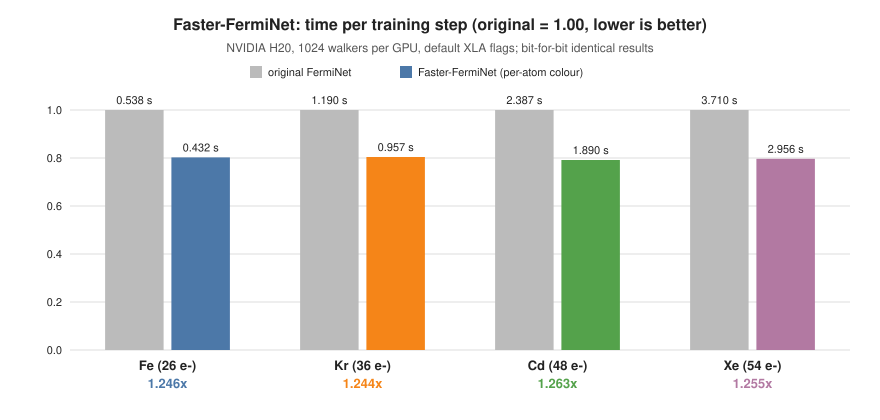
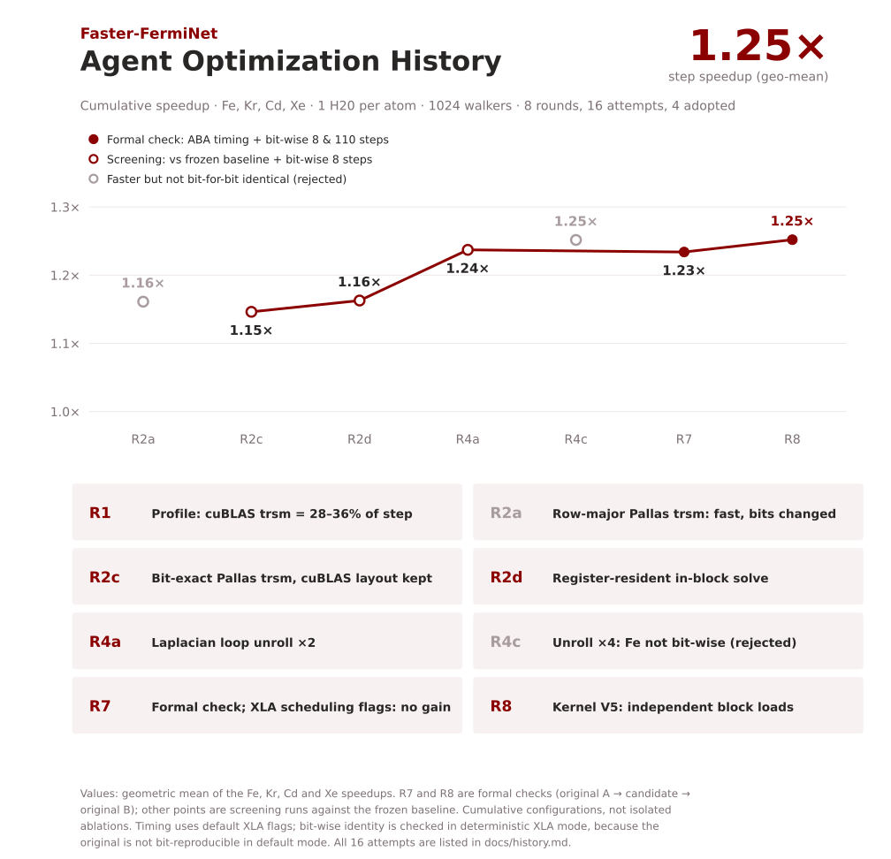
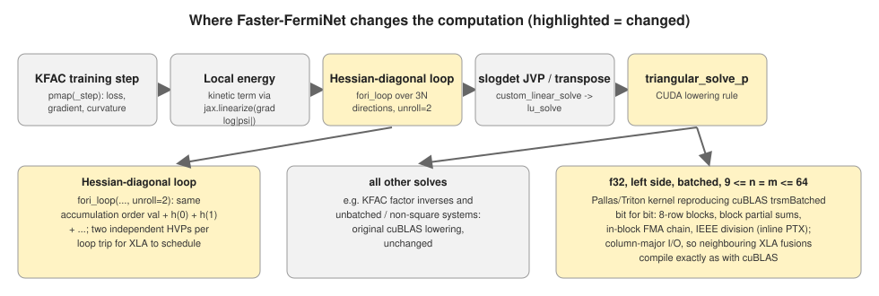

# Faster-FermiNet

[English](README.md) | [简体中文](README.zh-CN.md)

Infrastructure acceleration of [FermiNet](https://github.com/google-deepmind/ferminet) training, optimized following the [ResearchBoost-Agent](https://github.com/DAGroup-PKU/ResearchBoost-Agent) pipeline: freeze the task and the judge first, then in each round profile → attack one hotspot class → time → bit-wise check → log. The pinned optimized source, portable reproduction entry points and the recorded results are included.

**Status: 8 ResearchBoost-Agent rounds (16 attempts) completed; the final candidate passed the frozen timing and bit-wise gates on all four atoms.**

**1.25× faster FermiNet training steps for Fe, Kr, Cd and Xe on NVIDIA H20, bit-for-bit identical to the original, optimized by AI agents.**



| Implementation | Fe (26 e⁻) | Kr (36 e⁻) | Cd (48 e⁻) | Xe (54 e⁻) |
|---|---:|---:|---:|---:|
| Baseline, time / step (s) ↓ | 0.5383 | 1.1901 | 2.3870 | 3.7101 |
| **Faster-FermiNet**, time / step (s) ↓ | **0.4319** | **0.9569** | **1.8900** | **2.9564** |
| Speedup ↑ | **1.246×** | **1.244×** | **1.263×** | **1.255×** |

Measured with a full check on **NVIDIA H20 GPUs** (Hopper, 96 GB), one atom per GPU, **1024 walkers per GPU**.
The configuration is the upstream all-electron atom setup: KFAC, 10 MCMC steps per iteration, FermiNet
4×(256, 32), 16 full determinants, default Laplacian, `ano-rcc` pretraining, and Fe with spin polarisation 4.
Precision, hyper-parameters and random streams are unchanged.

Timing uses XLA's **default** flags. The original and Faster-FermiNet ran as independent processes in the
order original A → Faster-FermiNet → original B on the same GPU; the exact ratios are 1.2463 / 1.2438 /
1.2630 / 1.2549× (geometric mean 1.252×). Bit-for-bit identity is verified separately in XLA's
**deterministic** mode, because the original is not bit-reproducible in default mode (see
[Validation](#validation)).

## Quick Start

Install the [pinned environment](docs/reproduction.md#environment). The optimizations are switched on when
`ferminet` is imported; [scripts/configs/faster.env](scripts/configs/faster.env) lists the measured switches and
`scripts/configs/upstream.env` turns them off. Train an atom with the measured configuration:

```bash
pip install -r requirements.txt && pip install --no-deps -e .
ATOM=Xe bash scripts/run_atom.sh          # upstream entry point (python -m ferminet.main)
```

Reproduce the table on four GPUs (original A → Faster-FermiNet → original B, then the bit-wise records and the
gate verdict):

```bash
bash scripts/get_upstream.sh              # original FermiNet @ e9d5a604 -> third_party/ferminet-upstream
GPUS=0,1,2,3 bash scripts/run_benchmark.sh
GPUS=0,1,2,3 LONG_ITERS=110 PROBE=1 bash scripts/run_benchmark.sh   # + 110-step check + kernel probe
```

Tested with **JAX 0.7.2, cuBLAS 12.9.1.4, Python 3.11 and driver 535.261.03 on H20**. The portable launchers
repackage the measured protocol; they have not themselves been rerun end to end. See
[reproduction](docs/reproduction.md).

## Agent Optimization History

The optimization followed the [ResearchBoost-Agent](https://github.com/DAGroup-PKU/ResearchBoost-Agent) loop.
It took eight rounds and 16 attempts, and four changes were adopted. Points are cumulative configurations;
filled markers are formal checks and open markers are screening runs. Grey markers are attempts that were
faster but not bit-for-bit identical, and were rejected.



All 16 attempts, including those without gain, are listed in the [optimization history](docs/history.md).

## What changed

- **Bit-exact triangular solve.** In the original, batched cuBLAS `trsm` inside the Laplacian took 28–36 % of
  each step at ≈ 1 TFLOP/s. Its exact operation order was reverse-engineered: aligned 8-row blocks, block
  partial sums from +0 then subtract, an in-block FMA chain, and IEEE division. It was re-implemented as a
  Pallas/Triton kernel with inline-PTX rounding and installed as the CUDA lowering of `triangular_solve_p`
  for float32, batched, square systems with 9 ≤ n ≤ 64. Every other solve keeps cuBLAS.
- **Layout preserved.** The kernel reads and writes cuBLAS's column-major layout, so XLA compiles every
  neighbouring fusion exactly as before. A row-major version was faster but changed the bits.
- **Laplacian loop unrolled ×2.** The accumulation order is unchanged, and each loop trip holds two independent
  Hessian-vector products. Unroll 4 broke bit-identity on Fe and was rejected.



Three files differ from upstream: `ferminet/pallas_trsm.py` (new), `ferminet/__init__.py` and
`ferminet/hamiltonian.py`. See the [switch table](docs/reproduction.md#switches) and the
[bit-exact trsm method](docs/trsm_bitexact.md).

## Validation

**Timing and bit-wise use different XLA modes.** Timing runs with XLA's default flags, as upstream does. In
that mode two runs of the unmodified original with the same seed already differ at step 0 (Fe: E₀ −317.9158
vs −318.7558 Ha, recorded at batch 4096 during task formulation). Some XLA kernels use atomics, and MCMC
amplifies the last bits. `--xla_gpu_deterministic_ops=true` removes this, while disabling autotuning does not.
Bit-wise identity is therefore stated, and was checked, only in deterministic mode. Speed is claimed only
for default mode.

**Bit-wise check.** The original and Faster-FermiNet both ran with `--xla_gpu_deterministic_ops=true`, the same
seed and configuration. At **every step** of 8-step and **110-step** runs on Fe, Kr, Cd and Xe, the energy
bits, `pmove` and SHA-256 digests of every leaf of walkers, parameters, KFAC optimizer state and MCMC width
are identical. The 110-step runs cross the MCMC width adaptation at step 100. Before any candidate, the
original reproduced itself in this mode.

**Kernel check.** The Pallas solve matches the real cuBLAS path bit for bit (n 9–64, four variants, three
input scales) without the deterministic flag. See the [digests](docs/validation/bitwise_records.json).

**Timing.** Original A → Faster-FermiNet → original B ran as independent processes on the same GPU. Each run has
18 iterations: step 0 (compilation) and two warm-up steps are excluded, and the step time is the median of
three 5-step windows. The gate requires a speedup above max(1.02, 1 + 2 × A/B gap) and window ranges
below 10 %.

| Atom | Original A / B (s/step) ↓ | Faster-FermiNet (s/step) ↓ | A/B gap | Speedup ↑ |
|---|---|---:|---:|---:|
| Fe | 0.5389 / 0.5377 | 0.4319 | 0.22 % | **1.2463×** |
| Kr | 1.1903 / 1.1900 | 0.9569 | 0.03 % | **1.2438×** |
| Cd | 2.3869 / 2.3870 | 1.8900 | 0.00 % | **1.2630×** |
| Xe | 3.7099 / 3.7102 | 2.9564 | 0.01 % | **1.2549×** |

All thresholds are 1.020 and window ranges are ≤ 0.66 %. Raw records: [h20.json](docs/validation/h20.json);
comparison rules: [judge](docs/judge.md).

**Scope.** The kernel reproduces the pinned cuBLAS build on H20 (sm_90). On another GPU or cuBLAS version, run
`bash scripts/check_kernel.sh` and set `FERMINET_PALLAS_TRSM=0` if it reports mismatches. Only single-device runs
with 1024 walkers per GPU and real ground-state `laplacian='default'` were measured. The bench shortens
pretraining (20 iterations) and burn-in (10 steps); the timed step is unchanged. Start-up and compilation are
excluded from step time. Full training to convergence was not run, and deterministic-mode speed was not
measured.

## Why it stopped at 1.25×

The owner fixed the budget at 8 rounds. In the final profile, the network GEMMs already run near the H20's TF32
peak, and the memory-bound XLA fusions cannot be restructured without changing FMA contraction and therefore
the bits. The remaining lever is the solve kernel: about 1.5–1.7 ms at n = 54 against ≈ 0.25 ms at memory
speed, bound by load latency.

See [why it stopped here](docs/profile.md) and the directions that were tried and not adopted.

## Upstream FermiNet documentation

Based on [google-deepmind/ferminet](https://github.com/google-deepmind/ferminet) at `e9d5a604`, by DeepMind.
[Apache-2.0 license](LICENSE). The original README is kept in [README.upstream.md](README.upstream.md).
The optimization process follows [ResearchBoost-Agent](https://github.com/DAGroup-PKU/ResearchBoost-Agent);
this repository is an independent case study, not an official certification or endorsement.
