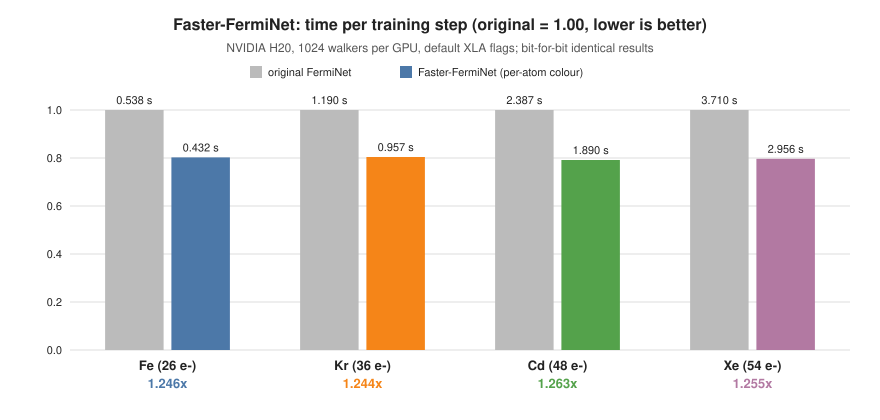
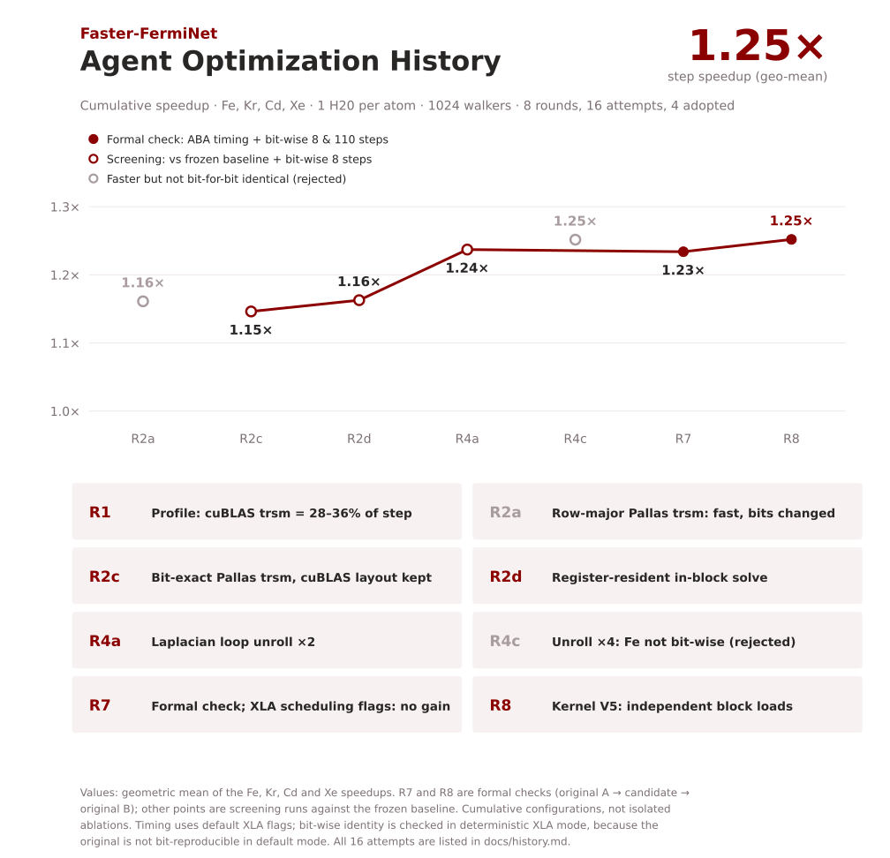
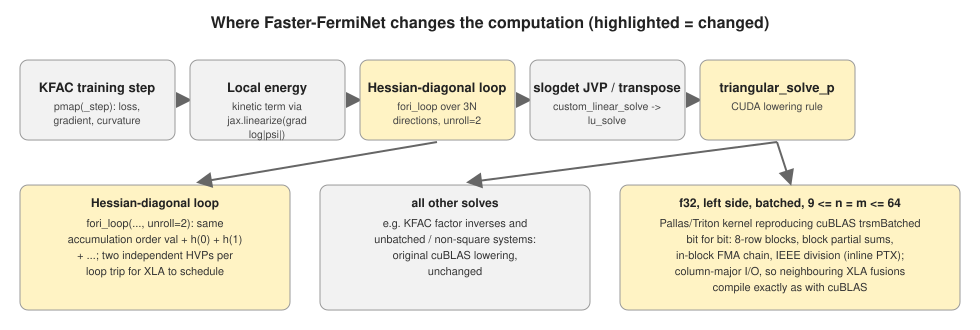

# Faster-FermiNet

[English](README.md) | [简体中文](README.zh-CN.md)

**在 NVIDIA H20 上，Fe、Kr、Cd、Xe 的 FermiNet 训练步提速 1.24–1.26×，结果与原始实现逐 bit 一致；由 AI agent 完成优化。**



| 原子（电子数） | 原始：每步时间 (s) ↓ | Faster-FermiNet：每步时间 (s) ↓ | 加速 ↑ | 逐 bit 一致 |
|---|---:|---:|---:|:---:|
| Fe (26) | 0.5383 | **0.4319** | **1.246×** | ✓ |
| Kr (36) | 1.1901 | **0.9569** | **1.244×** | ✓ |
| Cd (48) | 2.3870 | **1.8900** | **1.263×** | ✓ |
| Xe (54) | 3.7101 | **2.9564** | **1.255×** | ✓ |

数据来自正式检查。硬件为 **NVIDIA H20**（Hopper，96 GB），每个原子独占一张卡，**每卡 1024 个 walker**。
配置是上游的全电子原子设置：KFAC、每次迭代 10 步 MCMC、FermiNet 4×(256, 32)、16 个 full determinant、
默认 Laplacian；预训练基组为 `ano-rcc`，Fe 的自旋极化为 4。精度、超参数和随机数流均未改变。

计时在 XLA **默认**设置下进行，顺序为原始 A → Faster-FermiNet → 原始 B，在同一张卡上各自独立进程运行。
精确比值为 1.2463 / 1.2438 / 1.2630 / 1.2549×。逐 bit 一致性在 XLA **确定性**模式下验证，
因为原始实现在默认模式下本身就不能逐 bit 复现，详见[计时与逐 bit 验证](#计时与逐-bit-验证)。

## 快速开始

```bash
pip install -r requirements.txt && pip install --no-deps -e .
ATOM=Xe bash scripts/run_atom.sh          # 上游入口；优化默认开启
```

导入 `ferminet` 时优化即生效。[scripts/configs/faster.env](scripts/configs/faster.env) 列出实测所用开关，
`source scripts/configs/upstream.env` 可关闭全部优化。在四张卡上复现上表：

```bash
bash scripts/get_upstream.sh              # 原始 FermiNet @ e9d5a604 -> third_party/ferminet-upstream
GPUS=0,1,2,3 bash scripts/run_benchmark.sh                     # ABA 计时 + 逐 bit 检查 + 判定
GPUS=0,1,2,3 LONG_ITERS=110 PROBE=1 bash scripts/run_benchmark.sh   # 另加 110 步检查与内核比对
```

测试环境为 **JAX 0.7.2、cuBLAS 12.9.1.4、Python 3.11、驱动 535.261.03、H20**。换用其他 GPU 或 CUDA/JAX 版本时，
请先运行 `bash scripts/check_kernel.sh`（见[适用范围](#适用范围)）。详细步骤见[复现说明](docs/reproduction.md)。

## 计时与逐 bit 验证

| | 速度结论 | 一致性结论 |
|---|---|---|
| XLA 设置 | 默认（与上游运行方式一致） | 两份代码**都**设 `--xla_gpu_deterministic_ops=true` |
| 比较内容 | 每个训练步的墙钟时间 | 每一步：能量 bits、`pmove`，以及 walker、网络参数、KFAC 状态、MCMC 步长全部张量的 SHA-256 |
| 结果 | 1.244–1.263× | 四种原子在 8 步和 110 步中逐 bit 一致 |

**未经修改的原始实现**在默认模式下，同一 seed 跑两次，第 0 步能量就已不同（Fe：E₀ −317.9158 对 −318.7558 Ha；
四种原子均如此；该现象是在 batch 4096 的任务定义阶段记录的）。原因是 XLA 的部分 kernel 使用原子操作，
MCMC 又会放大末位差异。关闭 autotuning 不能消除这种差异，`--xla_gpu_deterministic_ops=true` 可以。
因此“与原始实现逐 bit 一致”只有在确定性模式下才有意义，验证也是在该模式下完成的。速度结论只针对默认模式；
确定性模式下的速度没有测量。被替换的 kernel 在两种模式下都是确定性的，并且在不加该 flag 时与 cuBLAS 逐 bit 相同。
详见[判定与证据](docs/judge.md)。

## Agent 优化历程

共 8 轮、16 次尝试。被否决的尝试中有两次虽然更快，但没有通过逐 bit 检查。



## 改动内容

- **逐 bit 一致的三角求解。** 原始实现中，Laplacian 内部的批量 cuBLAS `trsm` 占每步 28–36% 的时间，
  效率约 1 TFLOP/s。我们反推出它的精确运算顺序（按 8 行对齐分块；先求块内部分和（从 +0 开始），再相减；
  块内为 FMA 链；IEEE 除法），并用 Pallas/Triton kernel 重新实现，以 inline PTX 固定每一次舍入。
  它作为 `triangular_solve_p` 的 CUDA lowering 安装，只用于 float32、批量、方阵且 9 ≤ n ≤ 64 的求解；
  其余求解仍走 cuBLAS。
- **保持原有数据布局。** 该 kernel 按 cuBLAS 的列主序读写，XLA 因此对所有相邻融合的编译与原来完全相同。
  行主序版本更快，但改变了数值 bits。
- **Laplacian 循环展开 ×2。** 累加顺序不变，每次循环处理两个相互独立的 Hessian-向量积。
  展开 4 倍时 Fe 不再逐 bit 一致，因此被否决。



相对上游只改动三个文件：新增 `ferminet/pallas_trsm.py`，修改 `ferminet/__init__.py` 和 `ferminet/hamiltonian.py`。
开关见[复现说明 § 开关](docs/reproduction.md#switches)，方法见[逐 bit trsm](docs/trsm_bitexact.md)。

## 验证

**逐 bit。** 原始实现与 Faster-FermiNet 都在确定性模式下运行，使用相同 seed 和配置。
在 Fe、Kr、Cd、Xe 的 8 步运行和 **110 步**运行中（后者跨过第 100 步的 MCMC 步长调整），
**每一步**的能量 bits、`pmove`，以及 walker、参数、KFAC 优化器状态、MCMC 步长所有张量的 SHA-256 摘要都完全相同。
在评估任何候选之前，已确认原始实现在该模式下能复现自身。内核与真实 cuBLAS 路径的比对
（n 为 9–64，四种变体，三种输入尺度）没有任何元素不一致。摘要见 [bitwise_records.json](docs/validation/bitwise_records.json)。

**计时。** 原始 A → Faster-FermiNet → 原始 B，同卡独立进程。排除第一步（编译）和两步预热，取三个 5 步窗口的中位数。

| 原子 | 原始 A / B (s) | Faster-FermiNet (s) | A/B 差 | 判定阈值 | 加速 |
|---|---|---:|---:|---:|---:|
| Fe | 0.5389 / 0.5377 | 0.4319 | 0.22% | 1.020 | **1.2463×** |
| Kr | 1.1903 / 1.1900 | 0.9569 | 0.03% | 1.020 | **1.2438×** |
| Cd | 2.3869 / 2.3870 | 1.8900 | 0.00% | 1.020 | **1.2630×** |
| Xe | 3.7099 / 3.7102 | 2.9564 | 0.01% | 1.020 | **1.2549×** |

窗口波动 ≤ 0.66%。原始记录见 [h20.json](docs/validation/h20.json)，协议见[判定](docs/judge.md)。

## 适用范围

- **硬件与软件。** 该 kernel 复现的是 H20（sm_90）上所锁定 cuBLAS 版本的运算顺序。其他 GPU 或 cuBLAS 版本可能使用不同算法；
  请运行 `scripts/check_kernel.sh`，若报告不一致，设 `FERMINET_PALLAS_TRSM=0`。
- **工作负载。** 仅测量了这四种原子：单卡运行、每卡 1024 个 walker、实数基态、`laplacian='default'`。
  激发态、PsiFormer、周期体系、复数波函数、多卡 `pmap` 等路径没有做基准测试。
  kernel 的启用条件只依赖通用形状，超出已验证范围时自动回退到 cuBLAS。
- **基准中的缩短。** 为节省启动时间，基准把预训练缩为 20 次迭代、burn-in 缩为 10 步；被计时的训练步本身不受影响。
  启动（Hartree–Fock，30–90 s）和编译（20–35 s）不计入每步时间。
- **未测量的内容。** 完整训练至收敛以及达到目标精度所需的时间。由于算术完全相同，在确定性模式下它们应与原始实现逐步一致。

## 为什么停在 1.25×

任务方设定的预算为 8 轮。在最终 profile 中，网络 GEMM 已接近 H20 的 TF32 峰值；
受内存带宽限制的 XLA 融合无法重排，因为重排会改变 FMA 合并方式，从而改变数值 bits。
剩下可动的只有求解 kernel：n = 54 时约 1.5–1.7 ms，而按内存带宽估算约 0.25 ms，瓶颈在 load 延迟。
详见 [profile 与停止原因](docs/profile.md) 和[完整历程](docs/history.md)。

## 仓库结构

| 路径 | 内容 |
|---|---|
| `ferminet/` | 含优化的 FermiNet（上游 `e9d5a604` + 3 个文件） |
| `bench/` | 判定与工具：`fnbench.py`、`compare.py`、`gate.py`、`launch.py`、`make_jobs.py`、kernel/profile 工具 |
| `scripts/` | `run_benchmark.sh`、`check_bitwise.sh`、`check_kernel.sh`、`run_atom.sh`、`get_upstream.sh`、`configs/` |
| `docs/` | [判定](docs/judge.md)、[复现](docs/reproduction.md)、[历程](docs/history.md)、[逐 bit trsm](docs/trsm_bitexact.md)、[profile](docs/profile.md)、`validation/` |
| `task/formulation.json` | 冻结的工作负载、基线、判定规则和评测脚本哈希（ResearchBoost-Agent 风格） |
| `tests/` | kernel 契约测试（GPU）、模拟器测试（CPU） |

## 上游 FermiNet 文档

基于 [google-deepmind/ferminet](https://github.com/google-deepmind/ferminet) 的 `e9d5a604`，
采用 [Apache-2.0 许可证](LICENSE)。原始 README 保留在 [README.upstream.md](README.upstream.md)。
优化过程遵循 [ResearchBoost-Agent](https://github.com/DAGroup-PKU/ResearchBoost-Agent)。
