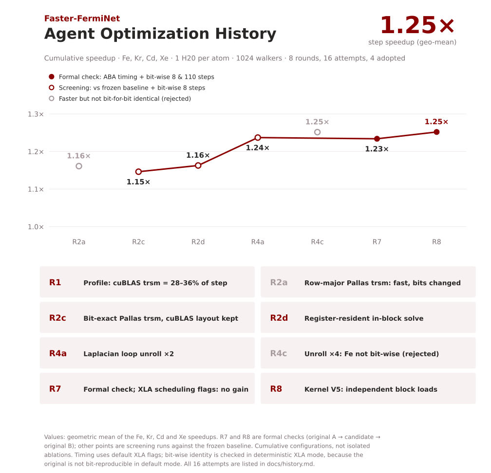

# Optimization history

The work followed the [ResearchBoost-Agent](https://github.com/DAGroup-PKU/ResearchBoost-Agent) loop:
freeze the task and judge first, then in each round profile → attack one hotspot class → time → bit-wise
check → log. The owner fixed the budget at **8 rounds**. Those rounds contained **16 optimization
attempts**. Speedups below are against the frozen batch-1024 baseline (one reference run per atom); the
final numbers come from the formal ABA gate in [judge.md](judge.md).

## Round 0 — formulation (frozen before any candidate)

- Workload, bench and bit-wise comparator frozen (see [reproduction.md](reproduction.md), `task/formulation.json`).
- Finding: the original is not bit-reproducible in default XLA mode; `--xla_gpu_deterministic_ops=true`
  makes it reproducible → bit-wise gate in deterministic mode, timing in default mode.
- Baseline (s/step): Fe 0.5376, Kr 1.1863, Cd 2.3900, Xe 3.7108; the reference reproduced itself bit for bit
  in deterministic mode on all four atoms.

## Round 1 — profile of the original

- GPU busy ≈ 99 % of wall time, so host overhead is irrelevant. The KFAC step (`pmap__step`) takes 95–97 %
  and MCMC takes 3–4 %.
- About 90 % of the step is the Laplacian `fori_loop` over 3N directions (one Hessian-vector product each).
  Per direction: 4 batched cuBLAS triangular solves, 6+ TF32 GEMMs, elementwise/reduce fusions, 4 D2D
  copies and 1 loop-invariant sort.
- Batched `trsm`: 28 % (Fe) to 36 % (Xe) of GPU time at ≈ 1 TFLOP/s, so it was attacked first.

## Round 2 — bit-exact Pallas triangular solve (4 attempts)

| Attempt | Change | Fe | Kr | Cd | Xe | Bit-wise |
|---|---|---:|---:|---:|---:|---|
| 2a | Pallas kernel, row-major I/O | 1.143 | 1.139 | 1.168 | 1.195 | ✗ all |
| 2b | same arithmetic, cuBLAS column-major I/O | 1.111 | 0.979 | 1.002 | 0.858 | ✓ |
| 2c | 8-row block tiles, direct transposed tile I/O | 1.169 | 1.108 | 1.141 | 1.168 | ✓ adopted |
| 2d | register-resident in-block solve | 1.178 | 1.129 | 1.174 | 1.171 | ✓ adopted |

The cuBLAS operation order was reverse-engineered offline and reproduced exactly
([trsm_bitexact.md](trsm_bitexact.md)). 2a matched cuBLAS on its own but changed the end-to-end bits:
the row-major Triton call made XLA re-layout neighbouring fusions and change a reduction order. The fix was
to keep cuBLAS's column-major layout (2b) and then recover the speed (2c, 2d).

## Round 3 — re-profile and kernel variants (2 attempts)

Profile of 2d (Xe): Pallas solves 27 %; two-electron-stream fusions and Triton GEMMs ≈ 25 %; cuBLAS GEMMs
≈ 16.5 % (near TF32 peak); h₂-mean reduction 5.4 %; envelope reduction 3.8 %. Details in [profile.md](profile.md).

| Attempt | Change | Fe | Kr | Cd | Xe | Bit-wise |
|---|---|---:|---:|---:|---:|---|
| 3a | static unroll of the kernel's inner loops | 1.159 | 1.131 | 1.193 | 1.174 | ✓ no gain, slower compile |
| 3b | index-tensor operand loads | 1.174 | 1.086 | 1.103 | 1.127 | ✓ slower |

## Round 4 — Laplacian loop unroll (4 attempts)

| Attempt | Change | Fe | Kr | Cd | Xe | Bit-wise |
|---|---|---:|---:|---:|---:|---|
| 4a | `fori_loop(..., unroll=2)` | 1.240 | 1.234 | 1.248 | 1.226 | ✓ adopted |
| 4b | unroll 3 | 1.215 | 1.223 | 1.261 | 1.232 | ✓ |
| 4c | unroll 4 | 1.239 | 1.231 | 1.272 | 1.266 | **✗ Fe** |
| 4d | unroll 6 | 1.201 | 1.233 | 1.273 | 1.223 | ✓ |

Unrolling keeps the accumulation order, but XLA's fusion decisions on the unrolled body depend on shapes.
With unroll 4, Fe's numbers changed (E₀ −318.735657 vs −318.735718). One setting must hold for every
atom, so unroll 2 was chosen (best geometric mean among the bit-wise-safe ones, cheapest compile).

## Round 5 — kernel column chunks (2 attempts)

| Attempt | Change | Fe | Kr | Cd | Xe | Bit-wise |
|---|---|---:|---:|---:|---:|---|
| 5a | 16 columns per program | 1.142 | 1.118 | 1.196 | 1.056 | ✓ slower |
| 5b | 32 columns per program | 1.240 | 1.139 | 1.191 | 1.135 | ✓ slower for n > 32 |

Splitting a matrix across programs duplicates coefficient loads and barriers, so one program per matrix
was kept.

## Round 6 — kernel tile orientation (1 attempt) + long validation

- 6a: working tile oriented `[column, row-in-block]` (V4): bit-wise ✓; 1.238 / 1.209 / 1.261 / 1.217, no gain.
- 110-step deterministic check of the round-4 configuration: identical on all four atoms.
- Nsight Compute at production shape: 72 % of stall samples are `long_scoreboard` (L1 hit 22 %, L2 hit 56 %,
  achieved occupancy 36 %), so the kernel is bound by load latency.

## Round 7 — XLA scheduling flags (2 attempts) + formal gate

- 7a `--xla_gpu_enable_while_loop_double_buffering=true` and 7b `--xla_gpu_enable_latency_hiding_scheduler=true`:
  both bit-wise ✓, both within ±0.5 % → not adopted.
- Formal ABA gate of the round-4 configuration: PASS, 1.244 / 1.225 / 1.243 / 1.224×.

## Round 8 — kernel V5 (1 attempt), final

- 8a: V4 orientation plus statically unrolled block updates, so the 8 coefficient and x loads of a block
  are independent and in flight together, which addresses the latency stall found in round 6.
- Formal ABA gate: **1.246 / 1.244 / 1.263 / 1.255×**, bit-wise ✓ over 8 and 110 steps, kernel probe ✓.
  Geometric mean +1.45 % over round 7, above the 1 % adoption rule set before the run, so it was adopted.

## Lessons

- Bit-exact library replacement must also preserve the **memory layout** the library imposed. Otherwise
  XLA compiles the neighbouring kernels differently and the bits change, even when the replaced kernel
  itself is exact.
- "Same math" transformations at the XLA level (loop unrolling) are not automatically bit-safe. Each
  setting has to pass the gate on every shape.
- A probe that compares against "the library" must make sure the library is really used. The first probe
  compared Pallas with itself because the lowering override was active in the same process.
- Hard-fail on CPU fallback (`JAX_PLATFORMS=cuda`). A silent fallback once produced a meaningless
  "0 mismatches" record.
